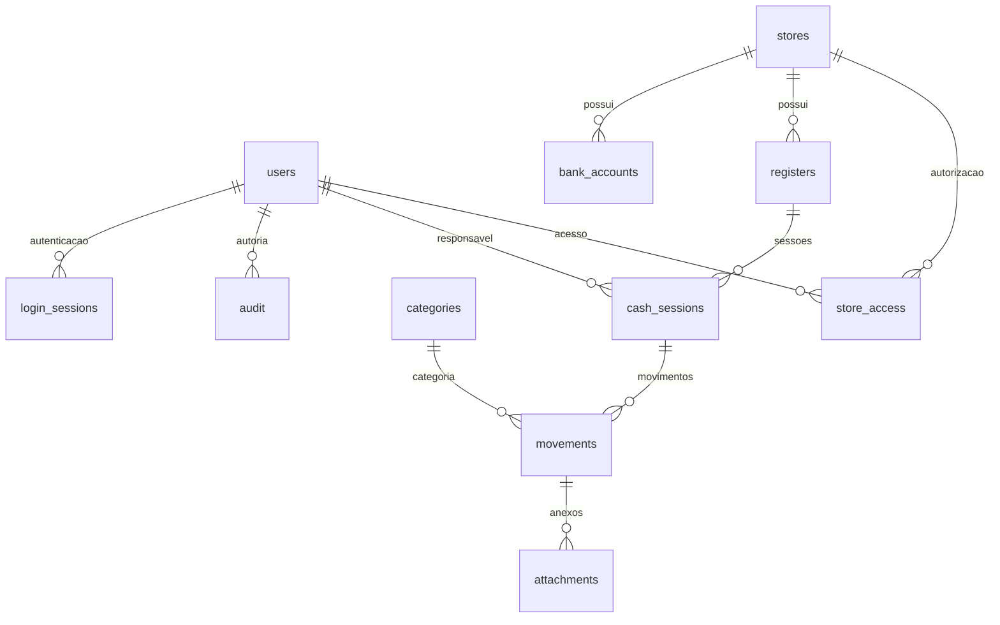

# GPGest

Aplicação de gestão financeira e operacional em português de Portugal. Projeto em `C:\Projetos\Site Loja\GPGest`, independente do site Desafio Salutar.

## Entrega atual — Fase 1

Funciona com React/TypeScript, FastAPI e PostgreSQL persistente:

- Autenticação com palavras-passe Argon2, cookie HttpOnly, expiração de 8 horas e saída de sessão.
- Perfis administrador, gestor, operador e consulta, com autorização por loja no servidor.
- Criação de lojas, caixas, contas bancárias, categorias e utilizadores.
- Abertura única por caixa, fundo inicial, passagem entre operadores com motivo.
- Recebimentos, pagamentos, despesas, reembolsos, reforços e retiradas para depósito.
- Numerário, cartão, transferência e outros meios separados; apenas numerário altera a caixa física.
- Transferências atómicas entre caixas, com dois movimentos ligados.
- Contagem por notas e moedas, diferenças justificadas, fecho e reabertura autorizada com histórico.
- Movimentos confirmados imutáveis: estorno com motivo, sem eliminação do original.
- Anexos privados PDF/JPG/PNG até 5 MB, máximo três por movimento.
- Relatório de fecho PDF e exportação de movimentos CSV.
- Auditoria e bloqueios transacionais PostgreSQL para concorrência.
- Contratos independentes para futuras integrações Wintouch e bancos.

Dinheiro guardado em **cêntimos inteiros**, sem ponto flutuante. A conversão de entrada usa Decimal. Datas guardadas com fuso horário e apresentadas em Europe/Lisbon.

Não emite documentos fiscais. Não substitui o Wintouch. Cartões são recebimentos registados, não saldos bancários confirmados. O saldo do dashboard corresponde às sessões **abertas**, evitando somar novamente o dinheiro de sessões históricas fechadas.

## Começar neste computador

1. Abra a pasta do projeto no VS Code.
2. Abra Terminal → Novo terminal (PowerShell).
3. Execute:

```powershell
cd 'C:\Projetos\Site Loja\GPGest'
powershell -ExecutionPolicy Bypass -File .\Instalar.ps1
powershell -ExecutionPolicy Bypass -File .\Iniciar.ps1
```

4. Abra **http://127.0.0.1:5174**.
5. Consulte `.local\ACESSO-LOCAL.txt` para o email e palavra-passe gerados. Este ficheiro e `.env` são privados e ignorados pelo Git.
6. Documentação interativa da API: **http://127.0.0.1:8001/docs**.

Pré-requisitos num computador novo: Python 3.13 e Node.js 22 ou superior instalados. O instalador descarrega o PostgreSQL 16 do fornecedor EDB e coloca-o exclusivamente em `.local`, sem instalar serviço global. São necessários cerca de 1 GB de espaço e acesso à Internet. A base usa a porta 55432, apenas em 127.0.0.1. Não é exposta à rede.

O primeiro arranque cria uma base **gpgest_demo**, uma loja e uma conta fictícias, identificadas como demonstração. Não são inseridas vendas ou saldos simulados. Todos os movimentos que adicionar são dados de teste desta base. Repetir instalação preserva a base existente.

### Arranque manual

Terminal 1:

```powershell
cd 'C:\Projetos\Site Loja\GPGest'
.\.venv\Scripts\python.exe scripts\init-local.py
cd backend
..\.venv\Scripts\uvicorn.exe app.main:app --host 127.0.0.1 --port 8001
```

Terminal 2:

```powershell
cd 'C:\Projetos\Site Loja\GPGest\frontend'
npm.cmd run dev
```

Os registos dos processos iniciados pelo script estão em `.local\backend.log`, `backend-error.log`, `frontend.log` e `frontend-error.log`. Não execute o iniciador repetidamente enquanto as portas já estiverem ocupadas.

Para parar os processos iniciados pelo script e a base local, execute `powershell -ExecutionPolicy Bypass -File .\Parar.ps1`. O script verifica o identificador e a data de arranque dos processos antes de os terminar. Os dados são preservados.

## Administração central de empresas

A página reservada **http://127.0.0.1:5174/plataforma** permite criar/desativar empresas e configurar/testar a API Wintouch de cada cliente. O acesso é separado das contas das lojas; consulte `.local/ACESSO-PLATAFORMA.txt`. Os dados operacionais são separados por esquema PostgreSQL e as chaves API ficam cifradas. A entrada normal passa a pedir o identificador da empresa (a empresa inicial é `demo`).

Veja [o guia da plataforma](docs/ADMINISTRACAO-PLATAFORMA.md) para configuração, cópias de segurança e limitações da integração. Não há importação automática nesta entrega.

A base inclui [11 tabelas de integração Wintouch](docs/TABELAS-WINTOUCH.md) por empresa: artigos, categorias, clientes/fornecedores, caixas, turnos, documentos/linhas, meios de pagamento, movimentos e controlo de sincronização. Os dados externos ficam separados dos saldos GPGest até validação explícita.

A [importação manual de artigos, entidades e caixas](docs/SINCRONIZACAO-WINTOUCH.md) está disponível em **Integrações → Wintouch**, com paginação, atualização sem duplicados e histórico. Apenas o administrador da empresa pode gerir a sincronização da sua empresa. Na demonstração exige confirmação explícita; não arranca automaticamente nem altera saldos financeiros.

A [importação de vendas e recebimentos](docs/VENDAS-WINTOUCH.md) está disponível em **Integrações → Importar vendas Wintouch**. Selecione loja e período. Documentos, pagamentos e saldos a crédito são apresentados nos menus de movimentos, com origem Wintouch, sem alterar as caixas locais.

As listagens de movimentos reais, previstos e Wintouch têm filtros por datas inclusivas, **Limpar datas** e paginação de 10, 25, 50 ou 100 registos. Nos previstos, a data usada é o vencimento. Cada listagem mantém os seus próprios filtros; mudar a loja, as datas ou o número por página repõe a primeira página. A paginação é aplicada no navegador aos registos carregados.

Os **totais do período selecionado** mostram créditos (entradas), débitos (saídas) e saldo (créditos menos débitos), somando todos os resultados filtrados, independentemente da página. Nos movimentos reais incluem as duas origens apresentadas. Nos previstos os totais usam o saldo ainda por liquidar; documentos de venda não apresentam totais de recebimentos.

## Guia de utilização

1. **Configurações**: crie lojas, caixas, categorias e equipa. Um administrador tem acesso a todas as lojas; os restantes utilizadores recebem acesso explícito. Na criação pela interface escolhe-se uma loja; a API aceita várias `store_ids`.
2. **Caixa diária**: abra uma caixa e introduza o fundo que realmente foi contado. Apenas uma sessão pode estar aberta por caixa.
3. **Movimentos reais**: transações efetivadas, com data, documento, entidade e meio de pagamento. Escolha a sessão, categoria, tipo e montante. Use **Anexos** para adicionar documentos privados.
4. **Movimentos previstos**: registe documentos a crédito de clientes ou fornecedores, indicando loja, categoria, entidade, documento, vencimento e montante. **Liquidar** regista pagamentos parciais ou totais numa caixa aberta da mesma loja e cria o movimento real associado. Os previstos não entram nos totais financeiros antes da liquidação; estornar um pagamento repõe o respetivo saldo por liquidar. A importação automática de documentos financeiros Wintouch continua por implementar.
4. Registe uma venda de 20 € em cartão: aparece nos totais de cartão, mas não aumenta o numerário esperado. Uma venda de 20 € em numerário aumenta-o.
5. **Passar caixa**: escolha o novo operador e descreva a passagem. O novo responsável precisa de acesso à loja.
6. **Fechar caixa**: introduza quantidades de notas e moedas. A aplicação calcula o total e a diferença. Se houver diferença, introduza uma justificação.
7. Após o fecho, descarregue o PDF interno. A gestão pode reabrir com motivo; o fecho anterior fica na auditoria.
8. Para corrigir um movimento, o gestor usa **Estornar** numa sessão aberta. As transferências são corrigidas com transferência inversa, preservando o par original.
9. **Relatórios**: consulte auditoria e exporte movimentos CSV. Não são relatórios fiscais nem um resultado contabilístico.

## Modelo de dados



Índice único parcial impede duas sessões abertas por caixa. As operações de caixa bloqueiam a sessão na base até ao commit. Transferências bloqueiam ambas em ordem determinística. `request_key` e `reversal_of` únicos impedem duplicação e estornos repetidos. Não existem endpoints de eliminação financeira.

## Dados reais e alojamento

Antes de usar em produção, crie **outra base PostgreSQL**, configure um `.env` com `APP_MODE=real`, credenciais próprias e `COOKIE_SECURE=true` atrás de HTTPS. Execute as migrações e `seed.py` nessa base nova: não será criada a loja fictícia. **Não transforme a base de demonstração em real mudando apenas a etiqueta.**

Use um utilizador de base de dados com os privilégios necessários apenas nesta base, um proxy HTTPS que sirva o frontend e encaminhe `/api` para FastAPI, backups externos e controlo de acesso aos ficheiros `.env` e backups. Não publique Vite dev nem PostgreSQL na Internet. O PostgreSQL local de desenvolvimento usa um administrador próprio apenas para facilitar a inicialização e testes; não copie este perfil de acesso para produção.

Configure `ALLOWED_ORIGINS` para a origem HTTPS exata do frontend (sem barra final). Em desenvolvimento é `http://127.0.0.1:5174`. A limitação de tentativas de login é local a cada processo; antes de alojar com vários processos, use também um limitador partilhado no proxy. A interface mostra até 200 sessões e 500 movimentos recentes; relatórios completos por período fazem parte da fase 2.

## Migrações e testes

```powershell
cd 'C:\Projetos\Site Loja\GPGest\backend'
..\.venv\Scripts\alembic.exe upgrade head
..\.venv\Scripts\python.exe -m pytest -q
cd ..\frontend
npm.cmd run build
```

Os testes usam esquemas temporários separados no PostgreSQL definido em `.env`; nunca removem tabelas da aplicação. Exigem autorização para criar esquemas. Execute apenas numa base de desenvolvimento, nunca em produção.

`backend/requirements.lock.txt` guarda as versões Python usadas nesta entrega, incluindo ferramentas de teste. Pode instalá-las com `pip install -r backend/requirements.lock.txt` para reproduzir o ambiente. O frontend tem `package-lock.json` e usa `npm ci`.

Teste de interface opcional: com PostgreSQL local e **apenas o frontend** iniciado, execute `.\.venv\Scripts\python.exe scripts\test-ui.py` na raiz. Requer Playwright instalado e `python -m playwright install chromium`. O script inicia e termina um backend de teste na porta 8001 e usa um esquema temporário. Guarda imagens de computador e telemóvel em `.local`, sem alterar a caixa da aplicação.

## Cópias de segurança e recuperação

```powershell
cd 'C:\Projetos\Site Loja\GPGest'
.\.venv\Scripts\python.exe scripts\backup.py
```

Guarda um ficheiro `.dump` em `backups`. Copie-o para armazenamento protegido fora deste computador. Faça uma cópia diária e antes de migrações. Os dumps incluem anexos e dados pessoais: restrinja o acesso.

Para testar a recuperação no ambiente de demonstração, execute `.\.venv\Scripts\python.exe scripts\test-restore.py` depois de criar um backup. Restaura para uma base temporária nova, compara contagens e remove apenas essa base temporária.

Para recuperar, crie uma **nova base vazia** com `createdb.exe` e use `.local\pgsql\bin\pg_restore.exe -h 127.0.0.1 -p 55432 -U gpgest -d NOME_DA_NOVA_BASE --clean --if-exists caminho\backup.dump`. Use este comando apenas na nova base vazia: prepara o esquema antes de restaurar. A ferramenta pede a palavra-passe da base (presente no `.env`). Altere `DATABASE_URL` para a base recuperada, inicie e verifique utilizadores, sessões e movimentos antes de substituir a base original. Nunca apague a base original para testar a recuperação. O backup inclui o esquema `public` da aplicação e exclui esquemas temporários de teste.

## Fases seguintes e dependências

- **Fase 2**: talões sequenciais de depósito, dinheiro em trânsito, receitas/despesas reconhecidas, pagamentos e indicadores. Uma retirada de caixa atual não cria automaticamente um talão ou confirmação bancária.
- **Fase 3**: artigos, lotes locais, validades, FEFO e alertas.
- **Fase 4**: CSV/Excel com pré-visualização e deduplicação, reconciliação parcial/agrupada; Wintouch após documentação confirmada.
- **Fase 5**: Open Banking com prestador autorizado e consentimento, previsões e automatizações.

As opções do menu destas fases indicam explicitamente que ainda não estão disponíveis. Não há endpoints externos inventados, sincronizações simuladas, importador CSV/Excel ou ligação bancária apresentados como funcionais.

### Informação necessária sobre o Wintouch

Versão e módulos usados; documentação de API ou estrutura de leitura autorizada; formatos de exportação; identificadores de lojas, artigos, recebimentos e documentos; tratamento de anulações; disponibilidade de lotes e validades. A futura integração só irá ler dados e deverá validar reimportações e correções antes de ser ligada à caixa real.

Referências técnicas: [segurança FastAPI](https://fastapi.tiangolo.com/tutorial/security/oauth2-jwt/) e [PostgreSQL para Windows](https://www.postgresql.org/download/windows/).
