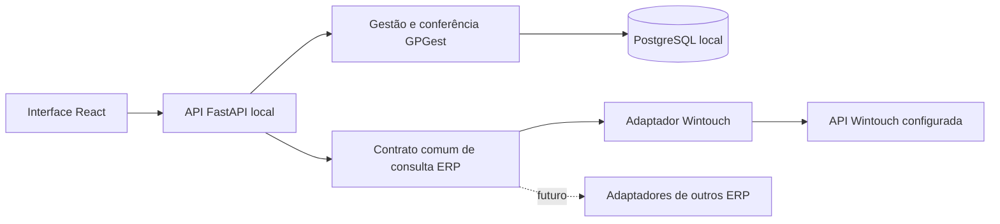

# GPGest local e evolução para vários ERP

> Atualização: os modos explícitos por empresa, capacidades, assistente de
> mudança e atualização periódica de catálogos estão implementados. Consulte
> [Modos de funcionamento](MODOS-FUNCIONAMENTO.md) para a configuração atual.
> As notas de evolução abaixo descrevem a arquitetura anterior e o trabalho
> adicional necessário para múltiplos conectores simultâneos.

O servidor FastAPI, o frontend e o PostgreSQL funcionam neste computador. A base
local é a fonte dos dados GPGest: contas, caixas, utilizadores, movimentos e
documentos guardados. Consultar um ERP é uma operação de integração separada.
Uma ligação à Internet só é necessária para operações que utilizam serviços
externos, como Wintouch Cloud, Google ou AT, e para a instalação inicial.

## Arranque local atual

- `Iniciar.bat` chama `Iniciar.ps1`, que inicia PostgreSQL, API e frontend.
- Interface: `http://127.0.0.1:5174`.
- API: `http://127.0.0.1:8001`.
- PostgreSQL: `127.0.0.1:55432`, com dados persistentes em `.local`.
- `Parar.ps1` termina os processos locais e conserva os dados.

O arranque atual destina-se a desenvolvimento e utilização neste computador.
O frontend usa Vite em desenvolvimento. Uma instalação definitiva numa loja
deverá servir o frontend compilado e manter os processos como serviços Windows.
Para vários computadores na loja, o servidor e a base ficam num computador
central da rede; os outros computadores acedem por navegador. Essa modalidade
ainda exige configuração de alojamento, origens, HTTPS e firewall.

## Camadas e responsabilidades



O núcleo calcula dinheiro em cêntimos inteiros e mantém as regras de caixa,
autorização por loja e auditoria. Um conector transforma os formatos do fornecedor
em documentos normalizados; não altera caixas nem cria lançamentos financeiros
por iniciativa própria.

## Camada comum implementada

`backend/app/integrations/erp.py` contém:

- `PurchaseDocument`: contrato de documento de compra em EUR, independente do
  ERP, com identidade externa, fornecedor, referência, data, valores e anulação.
- `PurchaseDocumentAdapter`: interface de consulta por período.
- `ERPRegistry`: registo de fábricas de conectores e seleção por identificador.
- `ERPIntegrationError`: erros da camada comum, sem depender do Wintouch.

O registo cria uma instância por consulta. Não guarda clientes HTTP nem
credenciais globais. Cada pedido deve construir a fábrica com a ligação da
empresa autorizada. Os adaptadores são código instalado no servidor; o nome de
um ERP fornecido pelo utilizador nunca deve provocar importação dinâmica de
módulos ou execução de código.

A consulta reúne e valida todos os documentos antes de os entregar à camada de
persistência. Rejeita IDs duplicados na mesma consulta, datas fora do intervalo,
montantes fracionários, valores que excedem o armazenamento e campos inválidos.
Notas de crédito podem ter total negativo. A consulta não tem operações de escrita
no ERP.

O mapeamento Wintouch passou para
`backend/app/integrations/wintouch_documents.py`. A função
`backend/app/erp_documents.py::snapshot` mantém a assinatura usada pelas rotas
existentes e passa agora pelo contrato comum. As permissões, validação do destino
HTTP, credenciais cifradas, auditoria e transações continuam nos serviços atuais.

## Acrescentar um ERP

1. Confirmar a documentação e as permissões de acesso do fornecedor.
2. Implementar um adaptador que receba o cliente/configuração da ligação e
   disponibilize `purchase_documents(start, end)`, devolvendo `PurchaseDocument`.
3. Registar uma fábrica com um identificador próprio, como `sage` ou `primavera`,
   apenas quando o conector estiver implementado e validado.
4. Testar paginação, anulações, notas de crédito, moedas, datas, limites,
   indisponibilidade e normalização sem alterar dados reais.
5. Ligar a configuração autorizada da empresa à seleção do adaptador no serviço
   de importação. Preservar a importação atómica e a autorização por loja.

Exemplo de utilização da camada comum, com adaptadores já construídos pela aplicação:

```python
registry = ERPRegistry()
registry.register("wintouch", lambda: WintouchPurchaseAdapter(reader))
documents = registry.purchase_documents("wintouch", start, end)
```

Cada novo recurso, como artigos, entidades, vendas e pagamentos, deve ganhar um
contrato próprio. Não se deve fazer um conector declarar que suporta escrita,
stocks ou pagamentos quando apenas consulta documentos de compra.

## Trabalho necessário antes de várias ligações simultâneas

Esta alteração cria a fronteira comum de consulta; a configuração e persistência
atuais ainda correspondem a uma ligação Wintouch por empresa. Não permite escolher
outro ERP na interface nem ligar dois ERP simultaneamente à mesma empresa.

Antes de ativar essa modalidade, são necessárias migrações e serviços para:

- **Ligações por empresa:** tabela com `company_id`, `provider`, identificador de
  ligação, empresa externa, configuração, segredo cifrado e estado ativo.
- **Identidade externa:** associar documentos e catálogos à ligação; usar uma
  restrição única por `(connection_id, resource, external_id)`. A identidade
  atual `(enterprise_id, external_id)` não distingue fornecedores ERP.
- **Execuções por ligação:** histórico, cursor e bloqueio de concorrência por
  ligação/recurso, generalizando as tabelas `WintouchSyncRun` e `WintouchSyncState`.
- **Correspondências locais:** mapear lojas, fornecedores, artigos e meios de
  pagamento de cada origem sem misturar saldos nem duplicar movimentos.
- **Configuração na plataforma:** seleção de conectores disponíveis, teste da
  ligação e permissões explícitas para cada capacidade.

As migrações devem converter a configuração Wintouch existente numa ligação
identificada e preservar documentos, associações e histórico. Só depois devem
ser ativadas várias origens na persistência e na interface.

## Funcionamento sem Internet e sincronização

O trabalho local usa a base persistida. Os documentos ERP já importados podem
ser consultados localmente. Sem ligação ativa, a conferência documental existente
identifica que está a usar o snapshot local. Uma ligação ativa que falha pode
bloquear uma operação que exige reverificação; não deve ser apresentada como
verificação concluída.

Ainda não existe uma fila geral de sincronização automática nem de escrita em
ERP. Se forem necessárias, implementar tarefas persistentes, repetição com
intervalos, idempotência e resultados auditados por ligação. Operações de escrita
precisam de contratos separados e confirmação adequada; importar um documento
não equivale a lançar uma despesa ou a registar o seu pagamento na origem.

Ficheiros `.env`, `.local/google.json`, chaves, dados PostgreSQL e backups locais
são privados. A distribuição da aplicação deve incluir código e configuração
de exemplo, sem copiar estes dados para outra instalação.
